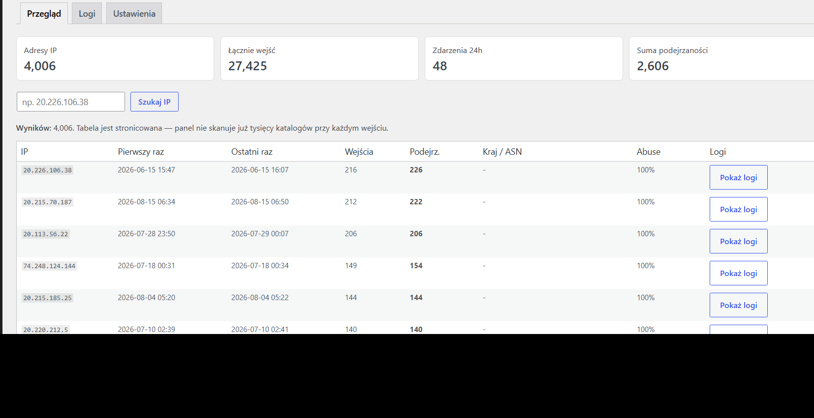
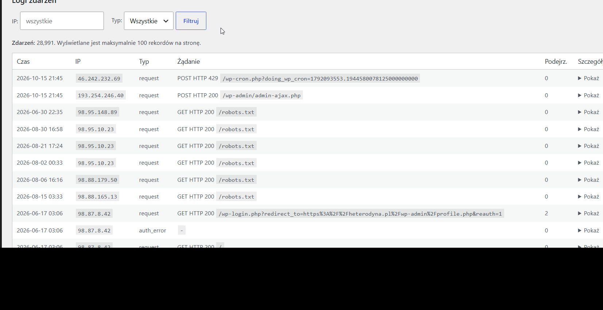
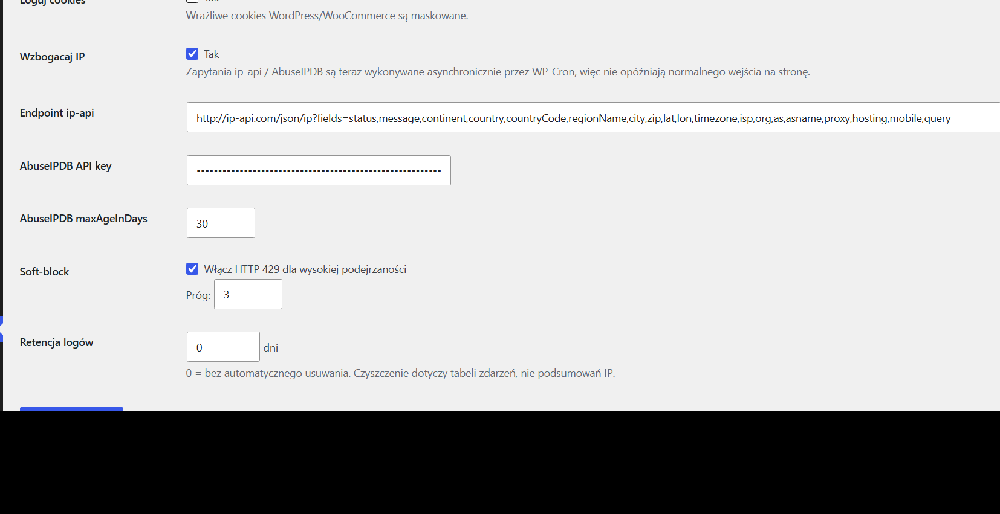
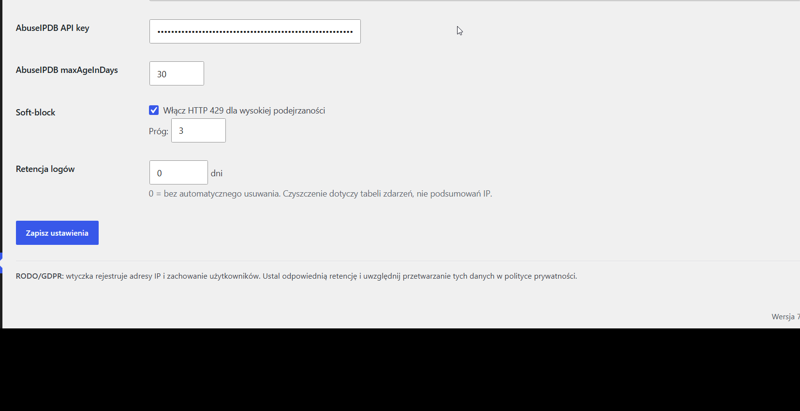

# IP Guard Logger

**Wersja: 01.001.0003**  
**Heterodyna Team Software**

Wtyczka WordPress do rejestrowania i analizy ruchu IP oraz zdarzeń bezpieczeństwa. Zapisuje żądania HTTP, błędy 404, nieudane próby logowania i błędy uwierzytelniania, a następnie pokazuje je bezpośrednio w panelu WordPressa.

W wersji **01.001.0003** logi są przechowywane w bazie WordPressa i wyświetlane w stronicowanych, kompaktowych tabelach. Dzięki temu panel nie musi przy każdym otwarciu skanować tysięcy katalogów z logami.

## Najważniejsze funkcje

- rejestrowanie ruchu HTTP i adresów IP,
- logowanie błędów 404,
- rejestrowanie nieudanych prób logowania i błędów autoryzacji,
- wynik podejrzaności dla ruchu i wykrytych sygnałów,
- lista IP z liczbą wejść, wynikiem podejrzaności i danymi reputacyjnymi,
- pełny podgląd zdarzeń bezpośrednio w panelu wtyczki,
- filtrowanie logów po IP i typie zdarzenia,
- stronicowanie dużych zbiorów danych,
- integracja z **ip-api**,
- opcjonalna integracja z **AbuseIPDB**,
- asynchroniczne wzbogacanie danych IP przez WP-Cron,
- opcjonalny soft-block **HTTP 429** dla ruchu przekraczającego ustawiony próg,
- maskowanie wybranych wrażliwych nagłówków i cookies,
- konfigurowalna retencja logów,
- import logów ze starszej wersji zapisującej dane w folderach per IP.

## Logi w panelu

Zakładka **Logi** pokazuje zdarzenia bez konieczności otwierania katalogów na serwerze. Widok został przygotowany tak, aby przy standardowym powiększeniu przeglądarki 100% mieścił się w panelu WordPressa bez ciągłego przesuwania tabeli w prawo.

W tabeli dostępne są m.in.:

- czas zdarzenia,
- adres IP,
- typ zdarzenia,
- metoda HTTP i status odpowiedzi,
- ścieżka żądania,
- wynik podejrzaności,
- szczegółowy JSON zdarzenia.

## Wydajność

Starsza wersja budowała podgląd przez skanowanie katalogów z logami i odczytywanie plików `ip-meta.json`. Przy kilku tysiącach adresów IP oznaczało to tysiące operacji dyskowych podczas jednego wejścia do panelu.

Obecna wersja korzysta z tabel w bazie WordPressa, indeksów i stronicowania. Panel pobiera tylko rekordy potrzebne do wyświetlenia aktualnej strony.

## Migracja starych logów

Po aktualizacji wtyczka może wykryć stare logi plikowe. W **IP Guard Logger → Przegląd** można uruchomić import danych do bazy.

Import:

- działa partiami,
- nie wymaga ręcznego kopiowania plików,
- nie usuwa automatycznie starych katalogów,
- pozwala zachować stare logi jako dodatkową kopię bezpieczeństwa.

## Ustawienia bezpieczeństwa

Można ustawić m.in.:

- logowanie nagłówków,
- logowanie cookies,
- wzbogacanie adresów IP,
- endpoint ip-api,
- klucz API AbuseIPDB,
- okres `maxAgeInDays`,
- próg soft-block.

## Instalacja

1. Pobierz katalog `wp-ip-guard-logger` lub przygotuj z niego archiwum ZIP.
2. W WordPressie przejdź do **Wtyczki → Dodaj wtyczkę → Wyślij wtyczkę na serwer**.
3. Zainstaluj i aktywuj wtyczkę.
4. Otwórz **IP Guard Logger** w menu administratora.
5. Sprawdź ustawienia proxy, wzbogacania IP, retencji oraz soft-block.

## Ważne

IP Guard Logger jest narzędziem do logowania i analizy. Nie zastępuje pełnego WAF-a ani poprawnej konfiguracji serwera.

Jeżeli WordPress działa za reverse proxy lub CDN, zaufanie do `X-Forwarded-For` powinno być włączane tylko dla znanych adresów zaufanych proxy.

Adres IP może stanowić daną osobową. Administrator strony powinien dobrać odpowiedni okres retencji i uwzględnić sposób przetwarzania danych w polityce prywatności.

---

# English

**IP Guard Logger** is a WordPress plugin for logging and analysing IP traffic and security-related events. It records HTTP requests, 404 responses, failed login attempts and authentication errors, then displays them directly in the WordPress admin panel.

Version **01.001.0003** stores logs in the WordPress database instead of separate per-IP folders. The admin interface uses indexed queries, pagination and a compact log table, which significantly reduces the amount of filesystem scanning required for large datasets.

## Features

- IP and HTTP request logging,
- 404 logging,
- failed login and authentication error tracking,
- suspicion scoring,
- paginated IP and event views,
- filtering by IP and event type,
- ip-api enrichment,
- optional AbuseIPDB integration,
- asynchronous external lookups through WP-Cron,
- optional HTTP 429 soft-blocking,
- masking of selected sensitive headers and cookies,
- configurable log retention,
- migration of legacy file-based logs.

## Author

**Heterodyna Team Software**  
https://heterodynateamsoftware.pl

## License

GPL-2.0-or-later
